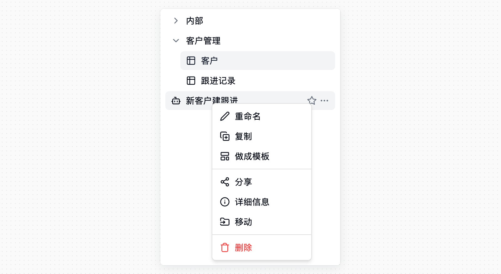
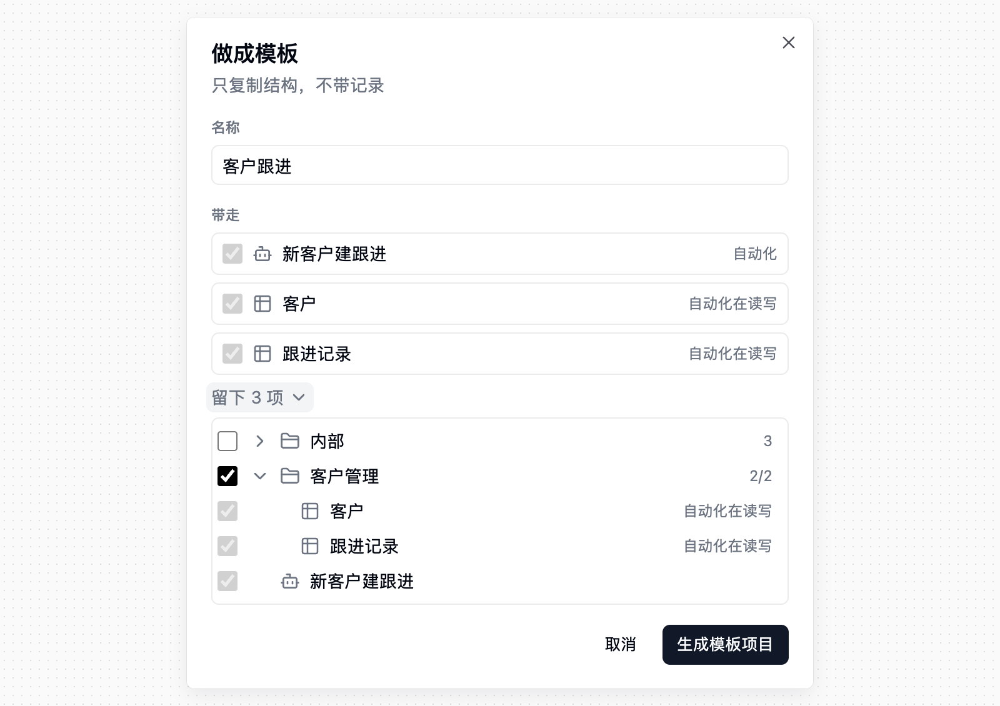
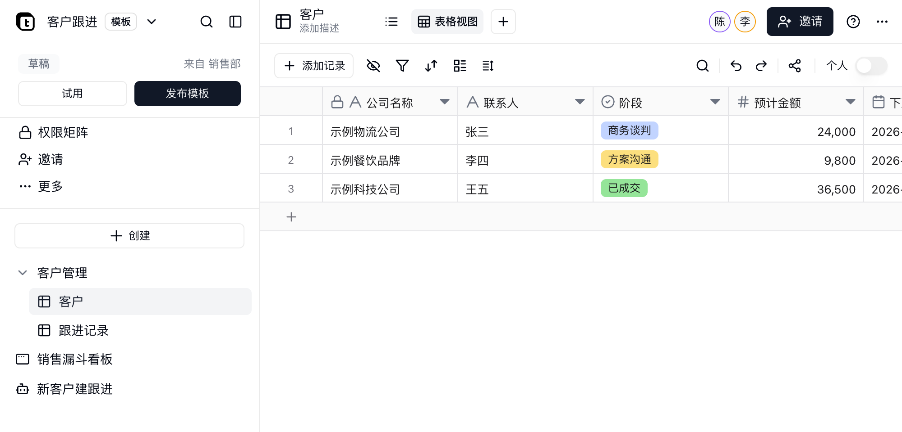
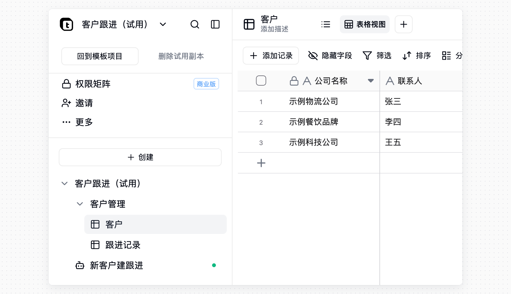
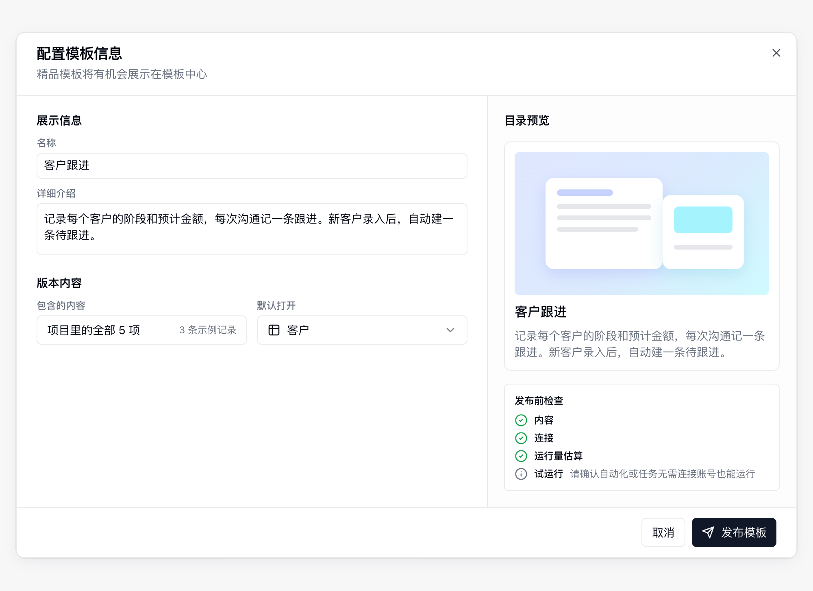
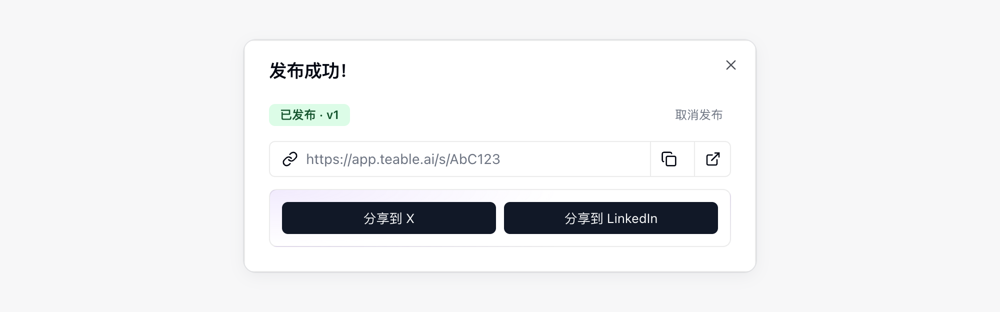
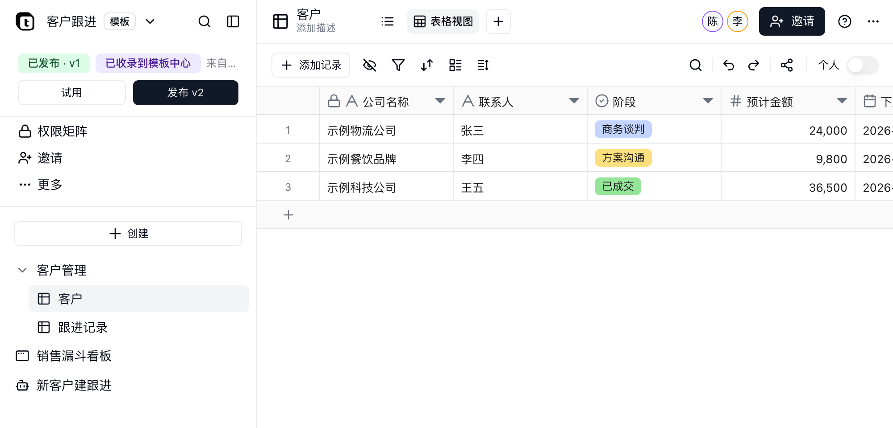
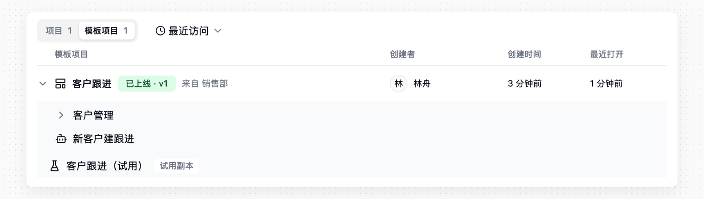

模板在**模板项目**里制作。你从在用的项目里挑出要分享的部分，Teable 复制一份结构，做成单独的模板项目；原项目和里面的数据不会改动，也不会被发布。

## 做成模板

在项目侧栏右键一张表、一个应用、一个自动化或一个文件夹，选择 **做成模板**。想从整个项目里挑选时，点击左上角的项目名称，选择 **做成模板**。

从条目的菜单进入时，它已经勾好；从项目名称进入时，在列表里勾选要带走的内容。应用、自动化和仪表盘用到的表会自动带上，右侧标出原因；其余内容收在 **留下 N 项** 里，可以展开再勾选。确认名称后点击 **生成模板项目**。

模板项目只复制结构：不带记录，自动化默认关闭，关联到没带走的表的字段会变成文本。做成模板需要你在原项目和空间中都有 **可搭建** 或以上权限。以前直接从项目发布、仍在上架的项目，项目名称菜单里显示的是 **发布到模板中心**，要从它做新模板，请从侧栏条目的菜单进入。

## 准备模板项目

点击 **生成模板项目** 后，Teable 会打开新的模板项目。它的名称后有 **模板** 标签，侧栏顶部显示状态、来源（**来自 销售部**，只有你看得到），以及 **试用** 和 **发布模板**。

Cuppy 会接着找出只属于你的内容，列出各自要换成什么，你确认后再替换，然后补上示例记录、起草安装引导。示例记录也可以自己补：发布时，模板项目里的记录会作为模板的示例数据一起发布。

## 试用

点击 **试用**，Teable 会像安装模板一样复制出一份试用副本并打开它，用来确认别人装好后看到的样子。点击 **回到模板项目** 返回，不需要时点击 **删除试用副本**。再次试用时，你的上一份试用副本会移到回收站。

## 发布模板

点击 **发布模板**，填写名称、详细介绍，上传封面，选择安装后默认打开的位置。封面和介绍是必填的，分享模板链接时会显示它们。模板项目会整个发布，**包含的内容** 显示全部项数和示例记录数。

右侧的 **发布前检查** 会拦下只属于你的内容：能打开这个空间或项目的人的姓名、邮箱和公司邮箱域名，以及看起来像 API 密钥的文本。把它们换掉，或点击 **去处理** 让 Cuppy 替换。**这是示例** 会把列出的内容一起标为示例并放行，只在它们全是虚构内容时使用。

**内容** 一项变成绿勾后，点击 **发布模板**。其余几行是提醒，不会拦住发布。

窗口中的 **安装引导** 可以为模板添加几步设置说明，每步包含标题、一句话说明、打开的位置和完成条件，可以 **让 Teable AI 起草**，或 **去项目里编辑**。完成条件包括：示例数据被改成真实内容、用户加了一条自己的记录、应用已发布、自动化运行成功一次、需要的账号已连接，或由用户自己标记完成。数据类条件在示例记录上必须还没做到，否则无法发布。

## 发布后

点击 **发布模板** 后模板立即上线：弹出 **发布成功！**，显示 **已发布 · v1** 和模板链接。拿到链接的人马上就能打开和安装，可以复制链接或直接分享出去。

发布之后还会经过审核，审核只决定模板是否收录到模板中心，不影响链接和安装。收录后侧栏多出 **已收录到模板中心**；暂不收录时你会收到通知，链接仍可打开、安装和分享。

之后继续在同一个模板项目里修改，点击 **发布 v2** 发布新版本。新版本同样立即上线，别人安装到的就是新版本；已收录的模板，模板中心也会展示新版本，之后再审核。

要让模板下线，在发布窗口点击 **取消发布**。取消后链接无法打开，模板中心也不再展示；别人已经安装的副本不受影响，之后可以重新发布。

## 在空间首页找到模板项目

空间首页分为 **项目** 和 **模板项目** 两栏。**模板项目** 一栏显示每个模板的状态和来源，展开一行可以看到它的内容和试用副本。要从空项目开始做，在这一栏点击右上角的 **新建模板项目**。

<Note>把模板项目移到回收站时，已发布的模板会一并取消发布：链接无法打开，模板中心也不再展示，从回收站恢复项目也不会重新发布。你的试用副本也会移到回收站；别人已经安装的副本不受影响。</Note>
