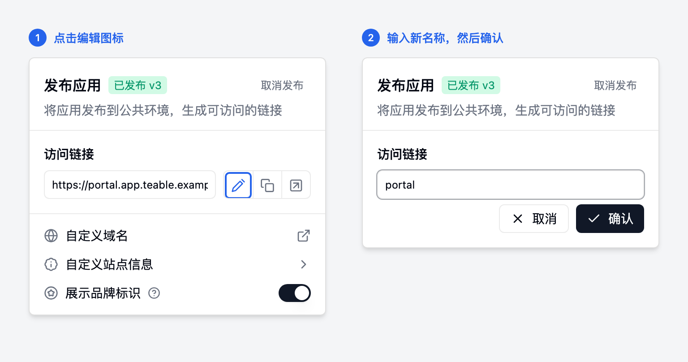
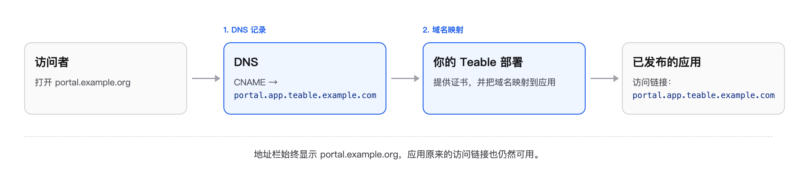

用 App Builder 发布的每个应用，都会在你部署的域名下获得一个独立地址：

```text
https://<名称>.app.<你的域名>      例如 https://crm.app.teable.example.com
```

这个地址本身就在你自己的域名下。如果想换地址，有两种方式：

| 你想要 | 谁来操作 | 跳转到 |
|---|---|---|
| 一个好记的名称，例如用 `crm.app.teable.example.com` 代替随机 ID | 任何有应用编辑权限的人，在应用编辑器里操作 | [修改访问链接](#修改访问链接) |
| 一个完全独立的域名，例如 `crm.example.org` | 服务器管理员，每个域名配置一次 | [让应用使用独立域名](#让应用使用独立域名) |

## 修改访问链接

修改立即生效，不需要改 DNS 或证书。

1. 在应用编辑器中打开应用，点击**发布**。
2. 在**访问链接**旁边点击编辑图标。
3. 输入新名称（小写字母、数字或连字符，并以字母或数字开头和结尾），点击**确认**。



应用随即可以通过 `https://<新名称>.app.<你的域名>` 访问。如果之前改过名称，旧名称会失效，已经分享出去的链接需要相应更新。

## 让应用使用独立域名

当应用必须放在 Teable 域名之外时使用，例如把客户门户放在 `portal.example.org`。访问者在地址栏里看到的始终是你的域名，不会发生跳转。



你需要准备：

- 应用当前的访问链接，例如 `portal.app.teable.example.com`。
- 独立域名的 DNS 管理权限。
- 部署环境的服务器权限（Docker）或 Helm values（Kubernetes）。

### 第 1 步：把域名指向你的部署

为独立域名添加一条 DNS 记录：

| 域名类型 | 记录 |
|---|---|
| 子域名，例如 `portal.example.org` | `CNAME` → 应用的访问链接，例如 `portal.app.teable.example.com` |
| 根域名，例如 `example.org` | `A` → 服务器（或 Ingress 负载均衡）的公网 IP。多数 DNS 服务商不允许在根域名上配置 `CNAME`。 |

继续之前先检查：`dig +short portal.example.org` 应返回你的访问链接或服务器 IP。

### 第 2 步：把域名映射到应用

<Tabs>
<Tab title="Docker">
在部署目录的 `.env` 中添加映射，多条映射用英文逗号分隔，不要加空格：

```bash .env
APP_CUSTOM_DOMAINS=portal.example.org=portal.app.teable.example.com
```

应用配置：

```bash
./apply.sh server --with-app    # 如果只部署运行时平面，去掉 --with-app
docker compose up -d
```

**证书**会自动处理：

- 如果你自己的证书（`TLS_CERT_FILE`）已经包含该域名，直接使用它。
- 否则会自动申请并续期 Let's Encrypt 证书。前提是域名已解析到服务器，且 80 和 443 端口可以从公网访问。

如果部署在不能从公网访问的内网，请把该域名加进你在 `TLS_CERT_FILE` 中提供的证书。
</Tab>
<Tab title="Kubernetes">
在 Helm values 中添加映射：

```yaml values.yaml
appRuntime:
  customDomains:
    - host: portal.example.org
      target: portal.app.teable.example.com
```

应用配置：

```bash
helm upgrade <release> <chart> -n <namespace> -f values.yaml
```

**证书**：chart 默认通过 cert-manager 以 HTTP-01 方式申请 Let's Encrypt 证书，前提是域名已解析到 Ingress 控制器的公网地址。如果部署在私有网络，请自行在 chart 所在的命名空间中为该域名创建 TLS Secret，然后引用它：

```yaml values.yaml
appRuntime:
  customDomains:
    - host: portal.example.org
      target: portal.app.teable.example.com
      tlsSecretName: portal-example-org-tls
```

如果 TLS 在集群前面的负载均衡上终止，则把该域名的证书配置在那里。
</Tab>
</Tabs>

### 第 3 步：验证

打开 `https://portal.example.org`，应用正常加载，地址栏保持为 `portal.example.org`。也可以在终端检查：

```bash
curl -sI https://portal.example.org    # 应返回 200，且不会跳转到访问链接
```

应用原来的访问链接仍然可用。需要登录的应用，访问者登录后会回到这个域名；如果多个域名指向同一个应用，会回到排在最前面的那个。

### 修改或移除域名

- **把域名改给另一个应用**：把映射的访问链接改成另一个应用的，然后重新应用配置。
- **应用改名或下线之后**，及时更新或删除对应映射：释放出来的访问链接可能被其他应用占用。
- **移除域名**：删除对应映射并重新应用配置，再删除 DNS 记录。

## 常见问题

| 现象 | 可能原因 |
|---|---|
| 页面显示 `app_runtime_host_not_bound` | 映射的访问链接与应用当前的访问链接不一致（例如改名之后），或应用尚未发布。 |
| 页面空白或浏览器提示证书不安全 | 映射里没有该域名，或配置尚未重新应用；DNS 还没有指向你的部署；80 端口被拦截，Let's Encrypt 无法验证域名；或你自己的证书没有包含该域名。 |
| 浏览器找不到该域名 | DNS 记录缺失或尚未生效，可以用 `dig +short <域名>` 检查。 |
